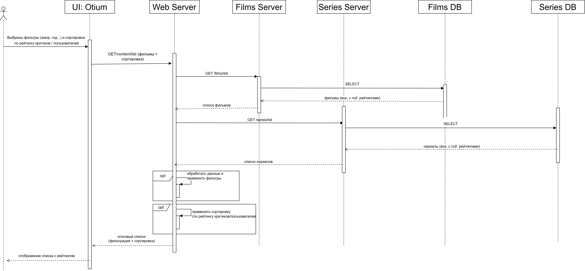

# 🎬 Проектирование REST API и постановка задач на разработку для онлайн-кинотеатра Otium

## Содержание

1. [О проекте](#о-проекте) — бизнес-контекст, проблема и цель доработки
2. [Заметки на полях](#заметки-на-полях) — архитектурные решения, краевые случаи и AI-инструменты
3. [Ключевые результаты](#ключевые-результаты) — метрики и объём проработанной архитектуры
4. [Спроектированные артефакты](#спроектированные-артефакты) — спецификация 7 методов REST API и тикет для разработки
5. [Визуализация архитектуры](#визуализация-архитектуры) — UML Sequence-диаграмма
6. [Состав репозитория](#состав-репозитория) — документация и файлы проекта

## О проекте

**Заказчик / продукт** — **Otium**, мультиплатформенный онлайн-кинотеатр (Web, Desktop, Mobile, Smart TV) на базе микросервисной архитектуры (5 сервисов + шлюз `Web Server API`).

**Бизнес-проблема** — пользователям было сложно выбирать фильмы и сериалы в большом каталоге, особенно новинки с малым количеством зрительских оценок, что приводило к увеличению времени поиска и оттоку аудитории с платформы.

**Цель проекта** — проанализировать документацию REST API в Swagger, спроектировать сквозную логику получения и сортировки контента по рейтингу кинокритиков (`criticsRating`) и зрительским оценкам (`rating`), а также подготовить исчерпывающее техническое задание для бэкенд-разработки.

**Инструменты и нотации:** UML (Sequence Diagram, Component Diagram), REST API, Swagger (OpenAPI), JSON, Postman, Draw.io.

## Заметки на полях

**Проработка краевых случаев и бизнес-логики**

1. **Обработка контента без рейтинга (`criticsRating = null`):** на интервью с заказчиком выяснилось, что часть контента (например, детские фильмы) не оценивается кинокритиками. Приравнивать отсутствие оценки к `0` было нельзя (иначе при сортировке по возрастанию такие фильмы попадали бы на первое место), а удалять из выдачи — невыгодно для бизнеса. Решение: при любом режиме сортировки (`asc` или `desc`) записи со значением `null` принудительно отображаются **в конце списка выдачи**.
2. **Разделение фильтрации и сортировки (`opt`-фреймы):** на уровне шлюза `Web Server` сначала выполняются опциональные фильтры (`opt`: жанр, год, эксклюзивность), и только затем — опциональная сортировка (`opt`) по выбранному параметру (`sortBy`) и направлению (`direction`).
3. **Использование существующих баз данных:** данные о рейтингах кинокритиков (дробное число от `1.0` до `10.0`) добавляются в существующие базы `Films DB` и `Series DB` без создания отдельного микросервиса.

**AI-assisted**

В процессе работы применялись LLM-инструменты для валидации JSON-контрактов в Swagger, проверки граничных условий сортировки (`null`-значения, `asc`/`desc`) и структурирования критериев приёмки в техническом задании.

## Ключевые результаты

- **-50% времени на согласования (Back-and-Forth)** между системным аналитиком и бэкенд-разработкой за счёт детальных JSON-примеров и описания всех краевых случаев.
- **100% прозрачность оценки спринта** в Story Points ещё до старта разработки.
- **Спроектированы изменения для 7 операций REST API в 3 сервисах:** `Films Server API` (2 метода), `Series Server API` (2 метода) и `Web Server API` (3 метода, включая добавление 2 query-параметров `sortBy` и `direction`).
- **Отрисована UML Sequence-диаграмма (версия 3)** на 6 участников с описанием SQL-запросов к БД и последовательных блоков обработки (`opt`).

## Спроектированные артефакты

**1. Спецификация доработок REST API (Swagger / JSON)**
- **`Films Server API` (`GET /films/list`, `GET /films`):** в JSON-ответы добавлено поле `criticsRating` (`number/null`, диапазон `1.0–10.0`).
- **`Series Server API` (`GET /series/list`, `GET /series`):** в JSON-ответы добавлено поле `criticsRating` (`number/null`).
- **`Web Server API` (`GET /content/list`, `GET /content/details`):**
  - В запрос `GET /content/list` добавлены **2 опциональных query-параметра**: `sortBy` (`rating` | `criticsRating`) и `direction` (`asc` | `desc`).
  - В тела ответов списка каталога и карточки контента добавлено поле `criticsRating` (`number`).

**2. Моделирование взаимодействия (UML Sequence Diagram v3)**
- В Draw.io разработана диаграмма последовательности для 6 узлов системы: `UI: Otium` → `Web Server` → `Films Server` → `Films DB` и `Series Server` → `Series DB`.
- Отражены SQL-запросы (`SELECT`) на получение полных списков (включая объекты с `null` рейтингами) и два последовательных фрейма `opt` на уровне шлюза `Web Server` для фильтрации и сортировки итоговой выдачи.

## Визуализация архитектуры

**UML Sequence-диаграмма получения, фильтрации и сортировки каталога (версия 3):**

**Ключевые решения на UML Sequence-диаграмме (6 участников):**
* **Сквозная трассировка взаимодействия:** отражена полная цепочка вызовов от интерфейса `UI: Otium` через шлюз `Web Server` до микросервисов `Films Server` (`GET /films/list`) и `Series Server` (`GET /series/list`) с обращением к базам данных (`Films DB` и `Series DB`).
* **Работа с неполными данными (`null`-рейтинги):** на уровне SQL-запросов (`SELECT`) из баз забираются все записи каталога, включая контент без оценки кинокритиков (`criticsRating = null`), чтобы не терять позиции при агрегации.
* **Последовательная обработка в блоках `opt`:** на уровне шлюза `Web Server` логика разделена на два независимых опциональных фрейма — сначала применяются пользовательские фильтры (жанр, год, эксклюзивность), и только затем выполняется сортировка (`sortBy`, `direction`) с выводом `null`-записей в конец списка.

*Ключевые особенности схемы:* шлюз `Web Server` запрашивает полные списки фильмов и сериалов (включая записи с `null` рейтингами) у сервисов `Films Server` и `Series Server`, после чего внутри опциональных блоков `opt` последовательно применяет фильтры и сортировку по выбранному рейтингу.

## Состав репозитория

| Файл | Описание |
| :--- | :--- |
| [Задачи на разработку (проект).pdf](Задачи%20на%20разработку%20(проект).pdf) | Техническое задание (тикет) для бэкенд-разработки: бизнес-цель, правила сортировки `null`-значений, примеры JSON-запросов и ответов для 3 сервисов |
| [sequence-diagram.png](sequence-diagram.png) | Визуализация UML Sequence-диаграммы межсервисного взаимодействия в высоком разрешении |
| `README.md` | Этот файл |
